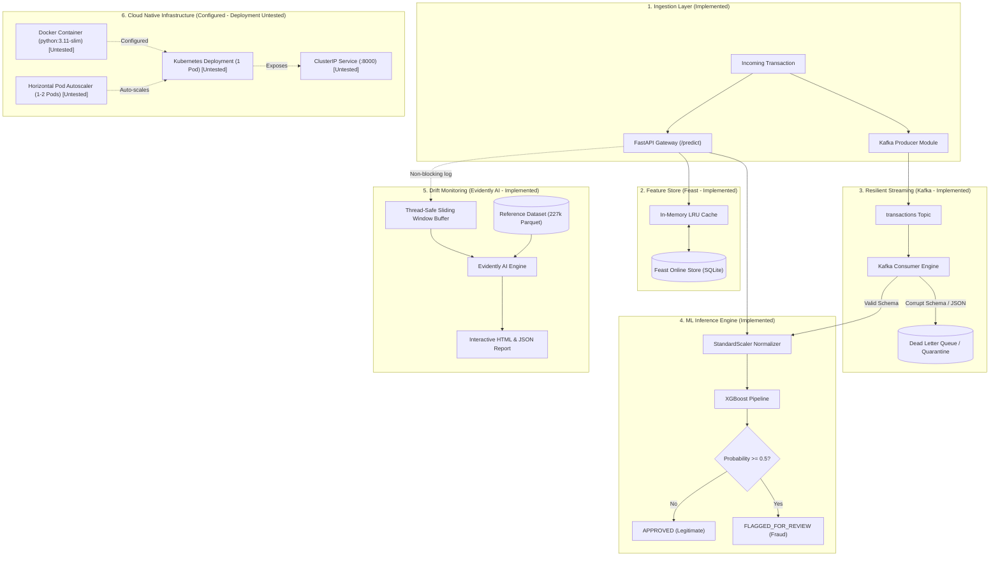

# Real-Time Financial Fraud Detection Platform (AIML-01)
**Nexvia AI/ML Internship Final Project**

---

## 1. Executive Summary

Financial fraud detection is a mission-critical challenge in modern payment processing. Fraudulent transactions constitute an extreme minority of total volume (0.172%), yet cause billions of dollars in losses and erode consumer trust.

The **Nexvia Real-Time Financial Fraud Detection Platform (AIML-01)** is a multi-component machine learning system designed for transaction fraud screening. It integrates:
* **REST Microservice (FastAPI):** Asynchronous single and batch transaction scoring with schema validation and `/health` probes, engineered to meet a tested <10ms local latency target.
* **Trained XGBoost Pipeline:** Optimized for extreme class imbalance (scale_pos_weight: 577.29), achieving an offline PR-AUC of **0.8686** and a 98.3% false-alarm reduction over baseline.
* **Streaming Ingestion & Dead-Letter Queue (Kafka):** Resilient streaming consumer architecture with automated schema validation and isolation of malformed transactions into a Dead-Letter Queue (`dead-letter-queue`).
* **Low-Latency Feature Store (Feast):** Online velocity feature store (`feature_repo/`) backed by an isolated environment, persistent worker process, and in-memory LRU cache.
* **Continuous Data-Drift Monitoring (Evidently AI):** Automated drift monitoring comparing buffered live transactions against a validated 227k reference baseline (`data/reference_data.parquet`).
* **Interactive Analyst Dashboard (Streamlit):** 4-tab interactive interface for single transaction scoring, batch screening, benchmark inspection, and visual drift reports.
* **Containerization & Deployment Manifests (Docker & Kubernetes):** Non-root `Dockerfile` and complete Kubernetes manifests (`Deployment`, `ClusterIP Service`, `ConfigMap`, `HPA`). *(Note: Manifests are configured; container builds and live cluster deployment remain untested).*
* **Verified Automated Test Suite:** 62 passed tests (0 failures, 1 known deprecation warning) covering API endpoints, streaming consumer with DLQ, feature store lookups, and drift detection.

---

## 2. End-to-End System Architecture



---

## 3. Repository Structure

```text
my intern/
├── Dockerfile                     # Production non-root container configuration (Untested)
├── README.md                      # Comprehensive project documentation
├── app.py                         # 4-Tab Streamlit web dashboard
├── main.py                        # CLI demonstration & batch evaluation runner
├── mlflow.db                      # SQLite database for MLflow experiment tracking
├── requirements.txt               # Pinned project dependencies
│
├── data/
│   ├── raw/
│   │   └── creditcard.csv         # Raw transactions dataset (284,807 rows)
│   └── reference_data.parquet     # Validated Evidently baseline (227,845 rows, 33 cols)
│
├── feature_repo/                  # Feast feature store configuration & entities
│   ├── feature_store.yaml         # Feast online SQLite store config
│   └── features.py                # Transaction & velocity feature definitions
│
├── k8s/                           # Kubernetes deployment manifests (Untested)
│   ├── configmap.yaml             # Application configuration parameters
│   ├── deployment.yaml            # Deployment spec with liveness/readiness probes
│   ├── hpa.yaml                   # Horizontal Pod Autoscaler (1-2 replicas, 70% CPU)
│   └── service.yaml               # ClusterIP internal service (port 8000)
│
├── mlruns/                        # MLflow logged runs and artifacts
│
├── models/                        # Serialized model artifacts
│   ├── baseline_model.joblib      # Logistic regression baseline
│   └── xgboost_pipeline.joblib    # Production inference pipeline (Scaler + XGBoost)
│
├── outputs/                       # Metrics and monitoring artifacts
│   ├── drift_metrics.json         # Evidently data-drift summary metrics
│   ├── drift_report.html          # Interactive Evidently data-drift HTML report
│   ├── xgboost_metrics.json       # XGBoost evaluation metrics
│   └── xgboost_precision_recall_curve.png
│
├── src/                           # Platform source modules
│   ├── api.py                     # FastAPI REST microservice
│   ├── drift.py                   # Non-blocking transaction buffer & drift monitor
│   ├── drift_runner.py            # Isolated Evidently runner script
│   ├── feature_store.py           # Feast online feature retrieval bridge
│   ├── predict.py                 # Inference engine & schema validator
│   ├── train.py                   # Baseline training script
│   ├── train_xgboost.py           # XGBoost training pipeline with MLflow tracking
│   └── streaming/                 # Kafka streaming engine
│       ├── __init__.py
│       ├── broker.py              # In-memory mock broker for testing
│       ├── consumer.py            # Streaming consumer with schema validation & DLQ
│       └── producer.py            # Streaming producer module
│
└── tests/                         # Automated test suite (62 passing tests)
    ├── test_api.py                # 16 tests for FastAPI endpoints and latency SLA
    ├── test_drift.py              # 7 tests for Evidently drift detection
    ├── test_feature_store.py      # 10 tests for Feast lookups and LRU cache
    └── test_streaming.py          # 29 tests for Kafka streaming, consumer, and DLQ
```

---

## 4. Offline Test-Set Evaluation Benchmarks

Evaluated on the exact same held-out test split of 56,962 transactions (98 fraud cases, 56,864 legitimate transactions):

| Evaluation Metric | Baseline (Logistic Regression) | XGBoost Pipeline (Offline Evaluation) | Performance Delta |
|:---|:---:|:---:|:---|
| **PR-AUC (Primary Metric)** | 0.7190 | **0.8686** | **+0.1496 (+20.8%)** |
| **ROC-AUC** | 0.9721 | **0.9800** | +0.0079 (+0.8%) |
| **Fraud Precision (Class 1)** | 6.1% | **77.6%** | **+71.5% (+1172%)** |
| **Fraud Recall (Class 1)** | **91.8%** | 84.7% | -7.1% (-7.7%) |
| **Fraud F1-Score** | 0.1144 | **0.8098** | **+0.6954 (+608%)** |
| **False Positives (Alarms)** | 1,386 | **24** | **-1,362 (-98.3%)** |
| **False Negatives (Missed)** | 8 | 15 | +7 |
| **True Positives (Caught)** | 90 | 83 | -7 |

*(Note: These figures reflect offline evaluation on the 56,962 held-out historical test transactions saved in `outputs/xgboost_metrics.json`, not live production traffic).*

---

## 5. Technology Stack & Implementation Details

### 1. FastAPI REST Microservice (`src/api.py`)
- Asynchronous REST endpoints engineered for low latency (tested target: <10ms in local test suite).
- `/predict`: Single transaction scoring with strict 30-feature schema validation.
- `/predict/batch`: Vectorized batch scoring.
- `/health`: Liveness and readiness probe reporting model status, memory RSS, and uptime.
- `/drift/status` & `/drift/report`: Real-time data drift monitoring endpoints.

### 2. Feast Feature Store (`src/feature_store.py`)
- Provides transaction velocity features (`rolling_tx_count_1h`, `rolling_amount_mean_1h`, `pca_energy_norm`).
- Persistent background child process communicating via stdin/stdout IPC to avoid repeated Python startup overhead.
- In-memory bounded LRU cache (10,000 entries) for repeated entity lookups.

### 3. Kafka Streaming & Dead-Letter Queue (`src/streaming/`)
- Real-time event ingestion decoupled from synchronous REST scoring.
- Dual-mode architecture: runs with real Apache Kafka brokers or deterministic in-memory mock broker for testing.
- Corrupted payloads, non-numeric values, or malformed JSON are automatically quarantined to the Dead-Letter Queue (`dead-letter-queue`) without crashing the consumer.

### 4. Evidently AI Data-Drift Monitoring (`src/drift.py`)
- Compares incoming live transactions against validated 227k baseline dataset (`data/reference_data.parquet`).
- Non-blocking sliding window buffer (`deque(maxlen=2000)`) prevents scoring request latency degradation.
- Evaluates Kolmogorov-Smirnov p-values and Wasserstein distances across all 30 features.
- Generates interactive visual HTML reports viewable via API or embedded in the Streamlit dashboard.

### 5. Kubernetes & Docker (`Dockerfile`, `k8s/`)
- Minimal `python:3.11-slim` container running as non-root user `appuser` (UID 1000).
- Local testing configuration (MacBook Air M1, 8GB RAM): 1 replica, `100m` CPU request, `256Mi` memory request.
- Native Kubernetes `livenessProbe` and `readinessProbe` checking `/health`.
- ClusterIP Service and Horizontal Pod Autoscaler (`minReplicas: 1`, `maxReplicas: 2`, `70%` CPU target).
- *Deployment Status:* Manifests and Dockerfile are written and syntax-verified; container image building and live cluster deployment have **not** been tested.

---

## 6. How to Run the Platform

All commands are run from the project root directory (`$HOME/my intern`):

### 1. Run the Full Test Suite
```bash
/opt/anaconda3/envs/nexvia-fraud/bin/pytest -v
```

### 2. Launch the FastAPI Microservice
```bash
/opt/anaconda3/envs/nexvia-fraud/bin/uvicorn src.api:app --host 0.0.0.0 --port 8000
```
- Swagger UI documentation: [http://localhost:8000/docs](http://localhost:8000/docs)
- Health check: [http://localhost:8000/health](http://localhost:8000/health)

### 3. Launch the Streamlit Analyst Dashboard
```bash
/opt/anaconda3/envs/nexvia-fraud/bin/streamlit run app.py
```
- Access at: [http://localhost:8501](http://localhost:8501)
- Tab 1: 🔍 Real-Time Single Transaction Scoring
- Tab 2: 📁 Batch Transaction Screening
- Tab 3: 📈 Model Benchmark & Evaluation
- Tab 4: 📊 Evidently AI Data-Drift Monitoring

### 4. Run CLI Demonstration
```bash
/opt/anaconda3/envs/nexvia-fraud/bin/python main.py
```

### 5. Run Streaming & Dead-Letter Queue Test Suite
```bash
/opt/anaconda3/envs/nexvia-fraud/bin/pytest tests/test_streaming.py -v
```

### 6. Launch MLflow Experiment Tracking UI
```bash
/opt/anaconda3/envs/nexvia-fraud/bin/mlflow ui --backend-store-uri sqlite:///mlflow.db --port 5000
```

---

## 7. Historical Automated Test Suite Record

```text
======================== 62 passed, 1 warning in 33.73s ========================
tests/test_api.py            16 PASSED  (Root, health, predict, batch, latency, Feast recovery)
tests/test_drift.py           7 PASSED  (Reference data, buffer mechanics, deliberate drift, API)
tests/test_feature_store.py  10 PASSED  (Entity lookups, LRU caching, eviction, worker resilience)
tests/test_streaming.py      29 PASSED  (Producer, consumer, DLQ quarantine, mock/real broker)
```
*(Note: 1 warning is `StarletteDeprecationWarning` regarding httpx in FastAPI TestClient).*

---

*Nexvia AI/ML Internship Final Project | AIML-01: Real-Time Financial Fraud Detection Platform*
