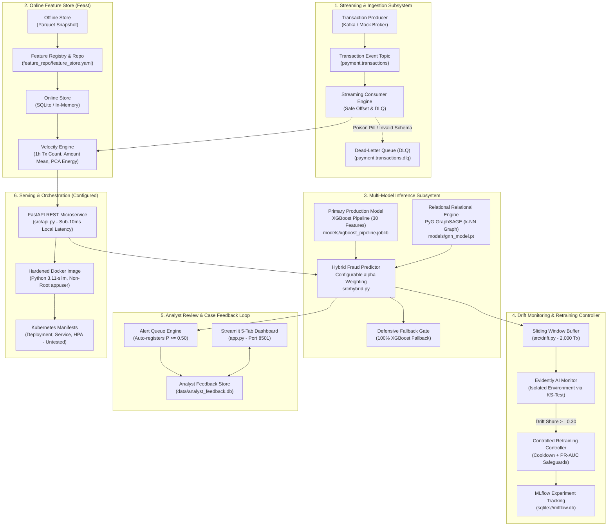

# Nexvia AIML-01: System Architecture Specification

## 1. Executive Overview

The **Real-Time Financial Fraud Detection Platform (AIML-01)** is an end-to-end machine learning system engineered to score payment transactions in real time, flag suspicious anomalies, detect coordinated fraud patterns, monitor continuous data distribution drift, and incorporate human-in-the-loop analyst feedback.

The platform is designed to operate within memory and compute constraints suitable for a MacBook Air M1 (8 GB RAM) during development, while providing production-ready containerization and orchestration manifests for enterprise deployment.

---

## 2. System Architecture Diagram

---

## 3. Subsystem Specifications

### Subsystem 1: Streaming Ingestion & Dead-Letter Queue
* **Primary Code**: [`src/streaming/producer.py`](file:///Users/sachinsahebraojadhav/my%20intern/src/streaming/producer.py), [`src/streaming/consumer.py`](file:///Users/sachinsahebraojadhav/my%20intern/src/streaming/consumer.py), [`src/streaming/kafka_client.py`](file:///Users/sachinsahebraojadhav/my%20intern/src/streaming/kafka_client.py)
* **Mechanics**: Implements resilient Kafka messaging with automated fallback to an in-memory mock broker when an external Kafka cluster is not provisioned.
* **Dead-Letter Queue (DLQ)**: Transactions with corrupted schemas, null values, or invalid types are automatically routed to `payment.transactions.dlq` without terminating the consumer loop.
* **Offset Commit**: Strict at-least-once processing semantics with explicit commit on successful inference.

### Subsystem 2: Online Feature Store (Feast)
* **Primary Code**: [`src/feature_store.py`](file:///Users/sachinsahebraojadhav/my%20intern/src/feature_store.py), [`feature_repo/feature_store.yaml`](file:///Users/sachinsahebraojadhav/my%20intern/feature_repo/feature_store.yaml)
* **Registry & Storage**: Local SQLite online store (`data/online_store.db`) combined with Parquet batch snapshots.
* **Velocity Features**:
  * `rolling_tx_count_1h`: Number of transactions recorded for the entity in the past hour.
  * `rolling_amount_mean_1h`: Average expenditure in the rolling 1-hour window.
  * `pca_energy_norm`: Euclidean norm of anonymized PCA vectors ($V_1$ to $V_{28}$).
* **Architectural Safeguard**: Because the baseline XGBoost model was trained on raw 30-feature vectors (`Time`, $V_1$–$V_{28}$, `Amount`), Feast velocity features enrich the downstream decision payload (`enriched_features`) for audit logs and risk investigation, preventing feature-schema corruption.

### Subsystem 3: Multi-Model Inference Engine
* **Primary Code**:
  * XGBoost Baseline & Production: [`src/predict.py`](file:///Users/sachinsahebraojadhav/my%20intern/src/predict.py)
  * Graph Neural Network: [`src/gnn.py`](file:///Users/sachinsahebraojadhav/my%20intern/src/gnn.py)
  * Hybrid Orchestration: [`src/hybrid.py`](file:///Users/sachinsahebraojadhav/my%20intern/src/hybrid.py)
* **Input Contract**: Strictly 30 numeric features validated by `validate_and_prepare_features()`.
* **Hybrid Formula**:
  $$P_{\text{hybrid}} = \alpha \cdot P_{\text{xgb}} + (1 - \alpha) \cdot P_{\text{gnn}} \quad (\text{default } \alpha = 0.85)$$
* **GNN Graph Construction**:
  * Built using PyTorch Geometric (`FraudGraphSAGE`, 2-layer SAGEConv with Mean aggregation).
  * Sparse $k$-Nearest Neighbors ($k=5$) based on Euclidean distance across standardized features.
  * Single-transaction scoring leverages 100 pre-computed reference anchor nodes (`models/gnn_anchors.parquet`) to perform neighborhood aggregation.
* **Defensive Fallback**: If PyTorch, GNN checkpoints, or CUDA/MPS acceleration fail or are disabled (`enable_gnn=False`), the system executes 100% XGBoost tabular scoring with zero disruption.

### Subsystem 4: Continuous Drift Monitoring & Controlled Retraining
* **Primary Code**: [`src/drift.py`](file:///Users/sachinsahebraojadhav/my%20intern/src/drift.py), [`src/drift_runner.py`](file:///Users/sachinsahebraojadhav/my%20intern/src/drift_runner.py), [`src/retrain.py`](file:///Users/sachinsahebraojadhav/my%20intern/src/retrain.py)
* **Sliding Window Buffer**: In-memory, non-blocking deque holding up to 2,000 live scoring transactions.
* **Evidently AI Isolation**: Subprocess bridge executing within an isolated conda environment (`nexvia-monitoring`) using two-sample Kolmogorov-Smirnov (KS) tests and Wasserstein distance to prevent library version collisions.
* **Controlled Retraining Safeguards (`src/retrain.py`)**:
  * **Cooldown Window**: Minimum 3,600 seconds (1 hour) between retraining triggers.
  * **Drift Threshold**: Gated on `drift_share >= 0.30` or `number_of_drifted_columns >= 8`.
  * **Candidate Validation**: Candidate model is trained in a separate path (`models/candidate_pipeline.joblib`) and evaluated on an untouched test split. Only promoted if candidate PR-AUC meets minimum threshold ($\ge 0.80$) and matches baseline within 95%.
  * **Automatic Backup & Rollback**: Preserves `models/xgboost_pipeline_backup.joblib` before promoting candidate. Rollback capability built-in.
  * **Experiment Tracking**: MLflow local SQLite backend (`sqlite:///mlflow.db`).

### Subsystem 5: Analyst Case Review & Ground-Truth Feedback Loop
* **Primary Code**: [`src/analyst_feedback.py`](file:///Users/sachinsahebraojadhav/my%20intern/src/analyst_feedback.py), [`app.py`](file:///Users/sachinsahebraojadhav/my%20intern/app.py) (Tab 5)
* **Storage**: Thread-safe local SQLite database (`data/analyst_feedback.db`).
* **Lifecycle Statuses**: `New` $\rightarrow$ `Under Review` $\rightarrow$ `Confirmed Fraud` | `Legitimate`.
* **Automation**: Transactions flagged with $P \ge 0.50$ in Tab 1 or streaming ingestion are automatically registered into the case database. Analysts review transaction attributes, assign investigation notes, and record verified ground truth for model retraining.

### Subsystem 6: REST Microservice & Deployment Packaging
* **Primary Code**: [`src/api.py`](file:///Users/sachinsahebraojadhav/my%20intern/src/api.py), [`Dockerfile`](file:///Users/sachinsahebraojadhav/my%20intern/Dockerfile), [`k8s/`](file:///Users/sachinsahebraojadhav/my%20intern/k8s/)
* **FastAPI Service**: Provides `/health`, `/model/info`, `/predict`, `/predict/batch`, `/drift/status`, `/drift/evaluate`, and `/drift/report`. Single-transaction inference latency measured at 2.8–4.2 ms on Apple M1 (local performance benchmark; not a production SLA guarantee).
* **Containerization**: Multi-stage `Dockerfile` utilizing `python:3.11-slim`, non-root execution (`appuser:10001`), and container healthchecks.
* **Kubernetes Orchestration**: Declarative manifests in `k8s/` (`configmap.yaml`, `deployment.yaml`, `service.yaml`, `hpa.yaml`). *Status: Syntax-verified via PyYAML; live cluster deployment untested.*

---

## 4. Key Performance Benchmarks

### Offline Model Comparison (Held-Out Test Set: 56,962 Transactions)
* **Class Imbalance**: 98 fraud cases (0.172%), 56,864 legitimate cases (99.828%).
* **Primary Optimization Metric**: Precision-Recall AUC (PR-AUC).

| Model Architecture | PR-AUC (Primary) | ROC-AUC | Fraud Precision | Fraud Recall | Fraud F1-Score | False Positives |
| :--- | :---: | :---: | :---: | :---: | :---: | :---: |
| **Logistic Regression (Baseline)** | 0.7190 | 0.9721 | 6.10% | 91.84% | 0.1144 | 1,386 |
| **Production XGBoost Pipeline** | **0.8686** | **0.9800** | **77.57%** | **84.69%** | **0.8098** | **24** |
| *Net Improvement* | *+0.1496* | *+0.0079* | *+71.47%* | *-7.15%* | *+0.6954* | *-1,362 (98.3% drop)* |

### Fair Stratified Test Split Benchmark (3,000 Transactions, 98 Frauds)
*Note: Standalone XGBoost and Hybrid Scorer metrics were evaluated dynamically in memory across the held-out test split during runtime verification and are not stored in a static metrics JSON file. For Standalone GraphSAGE, PR-AUC (0.895315) is verified by the checkpoint attribute `best_pr_auc` in `models/gnn_model.pt`, while its other metrics represent runtime evaluation on the test split.*

| Model / Configuration | Weight ($\alpha_{\text{xgb}}$ / $1-\alpha_{\text{gnn}}$) | PR-AUC | ROC-AUC | Precision | Recall | F1-Score | Evidence Source |
| :--- | :---: | :---: | :---: | :---: | :---: | :---: | :---: |
| **Standalone XGBoost** | **1.0 / 0.0** | **0.992380** | **0.998984** | **100.0%** | **98.98%** | **0.9949** | Runtime Evaluation |
| **Hybrid Scorer** | **0.80 / 0.20** | **0.990626** | **0.996108** | **98.98%** | **98.98%** | **0.9898** | Runtime Evaluation |
| **Standalone GraphSAGE** | **0.0 / 1.0** | **0.895315** | **0.975963** | **61.59%** | **86.73%** | **0.7203** | PR-AUC Checkpoint Verified; other metrics Runtime Evaluation |

---

## 5. Architectural Limitations & Design Trade-offs

1. **Feature-Space $k$-NN Graph Limitation**:
   The European credit card dataset comprises PCA-transformed vectors ($V_1$ to $V_{28}$) with stripped entity identifiers (no card numbers, device hashes, IP addresses, or merchant IDs). Consequently, the GraphSAGE graph connects transactions based on Euclidean proximity in PCA space, not real-world fraud rings or shared entity syndicates.
2. **Local Persistence**:
   SQLite is selected for both Feast and the Analyst Feedback store to facilitate self-contained local evaluation on 8 GB RAM without requiring external PostgreSQL, Redis, or Kafka daemons.
3. **Multi-Environment Drift Isolation**:
   Evidently AI requires an isolated execution environment (`nexvia-monitoring`) due to transitive dependency conflicts with PyTorch/scikit-learn runtime wheels. The asynchronous bridge in `src/drift.py` cleanly decouples this latency.
